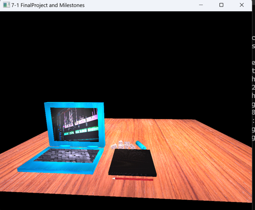

# Interactive 3D Office Desk Scene

## Project Overview

## Project Screenshot

The completed 3D office desk scene featuring textured objects, lighting, and material properties rendered using OpenGL.

An interactive 3D visualization developed using C++ and OpenGL as part of the CS-330 Computer Graphics and Visualization course at Southern New Hampshire University.

The project recreates a real-world office desk environment featuring a laptop, notebook, pencil, and textured wooden desk. Users can navigate the scene through an interactive virtual camera.

## Technologies Used

- C++
- OpenGL
- GLFW
- GLM
- Visual Studio

## Key Features

- Interactive 3D scene rendering
- Texture mapping and material customization
- Configurable lighting and reflections
- Keyboard and mouse camera navigation
- Multiple camera views and projections
- Object scaling, rotation, and positioning
- Modular and reusable rendering functions

## Navigation Controls

| Input | Function |
|---|---|
| W | Move forward |
| S | Move backward |
| A | Move left |
| D | Move right |
| Q / E | Vertical camera movement |
| 1–4 | Switch views or projections |
| Mouse | Control camera direction |

## Code Organization

The project utilizes reusable functions to improve maintainability and organization.

- `CreateGLTexture()` — Loads image textures into OpenGL memory.
- `SetShaderTexture()` — Applies textures to objects.
- `SetShaderMaterial()` — Configures material properties and shininess.
- `SetupSceneLights()` — Configures scene lighting.
- `SetTransformations()` — Controls object scale, rotation, and position.
- `ProcessKeyboardEvents()` — Handles keyboard-based navigation.

## Testing and Problem Solving

The scene was developed incrementally through continuous visual testing and refinement.

One challenge involved excessive light reflection obscuring object textures. This was addressed by adjusting material shininess and lighting properties to improve the visibility and realism of the scene.

## Skills Demonstrated

- Object-oriented programming
- Technical troubleshooting
- Modular software design
- Iterative development
- Computer graphics and visualization
- Software testing and debugging

## Academic Context

Completed in April 2024 as a final project for the Computer Science bachelor's degree program at Southern New Hampshire University.

## Author

Alexis Del Rosario

# CS-330-Computer-Graphic-and-Visualization

How do I approach designing software?
    What new design skills has your work on the project helped you to craft?
    What design process did you follow for your project work?
    How could tactics from your design approach be applied in future work?
    
Some new design skills that I acquired after working on this project are:
Customizing and adding shapes to form objects in OpenGL.
Understanding of OpenGL format.
Became more familiar with Visual Studio.
Testing.
In the design process, I first try to understand the requirements of the project I will be working on. I gather information such as: Who the users are? What are their needs?, and What problem does it solve? I then conduct some research and analysis. I start by analyzing existing solutions and seeing what aspects can be improved and innovated. I then start to create ideas about aspects specific to my program. This can be things like UI and specific functions required for the program to run efficiently. I then put my thoughts into action and start designing the UI and/or coding. I receive feedback from professors and implement their ideas to my work.
In future work I shall continue to prioritize user needs and feedback. By doing this, I think about the others involved in the project and refrain from implementing only what I feel is suitable. 

How do I approach developing programs?
    What new development strategies did you use while working on your 3D scene?
    How did iteration factor into your development?
    How has your approach to developing code evolved throughout the milestones, which led you      to the 
    project’s completion?
    
New development strategies that I used in my 3D scene include:
Using libraries and frameworks specific to 3D graphics.
Continuously testing the output of my code to determine if it was a good fit for the project.
Created code for lighting, textures, rendering, etc.
Use of rotating, scaling, and positioning techniques.
Iteration allowed me to view my project with multiple different POVs. Everytime I added, removed or adjusted something in the code I would get feedback from the output. You sometimes get a different view on your work and can use these new ideas to your advantage. It also allowed me to continuously improve the project. 
Constantly working on the milestones allowed me to familiarize myself with OpenGL and even more with Visual Studio. I was also able to add to my project bit by bit and focus on these bits one at a time. 

    
How can computer science help me in reaching my goals?
    How do computational graphics and visualizations give you new knowledge and skills that can be applied in 
    your future educational pathway?
    How do computational graphics and visualizations give you new knowledge and skills that can be applied in 
    your future professional pathway?

If I get the opportunity to work in another class with similar projects, I will be more prepared to take on the challenge. Using the knowledge I have gained from this project I feel more confident in creating a logo or scene for an employer or customer. 
